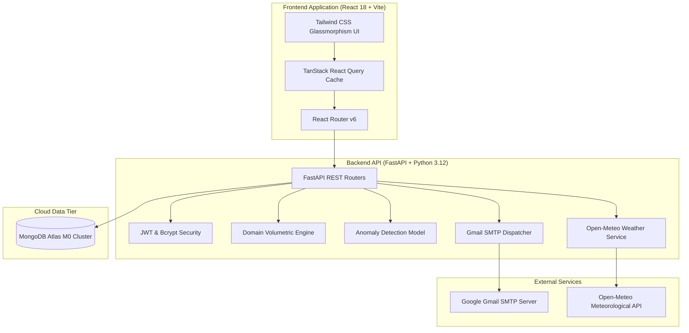
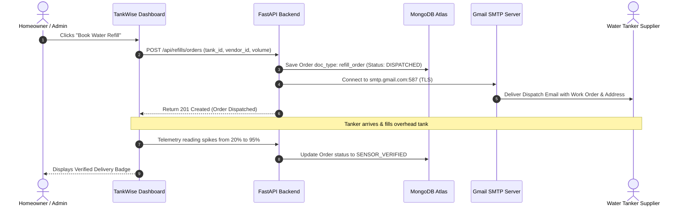

# 💧 TankWise – Water Tank Usage Intelligence & Refill Cycle Analysis

> **An Autonomous IoT Telemetry, Consumption Prediction, Automated Vendor Logistics & Weather-Driven Rainwater Harvesting Platform.**

---

## 📌 Table of Contents
1. [Executive Overview](#-executive-overview)
2. [Problem Statement](#-problem-statement)
3. [Proposed Solution & Innovation](#-proposed-solution--innovation)
4. [Complete System Modules](#-complete-system-modules)
   - [Module 1: Tank Registry & 3D Geometric Modeling Engine](#module-1-tank-registry--3d-geometric-modeling-engine)
   - [Module 2: Time-Series Telemetry & Ingestion Pipeline](#module-2-time-series-telemetry--ingestion-pipeline)
   - [Module 3: Consumption Rate & Refill Cycle Analytics Engine](#module-3-consumption-rate--refill-cycle-analytics-engine)
   - [Module 4: Smart Refill & Vendor Logistics Hub (With Automated Email Dispatch)](#module-4-smart-refill--vendor-logistics-hub-with-automated-email-dispatch)
   - [Module 5: Weather-Driven Demand & Rainwater Harvesting Optimizer](#module-5-weather-driven-demand--rainwater-harvesting-optimizer)
   - [Module 6: Multi-Tier Anomaly & Leak Detection Engine](#module-6-multi-tier-anomaly--leak-detection-engine)
   - [Module 7: Intelligence Reporting & Export Engine](#module-7-intelligence-reporting--export-engine)
   - [Module 8: Security, Role-Based Access & Email OTP Recovery](#module-8-security-role-based-access--email-otp-recovery)
5. [System Architecture & Data Flow](#-system-architecture--data-flow)
6. [Technology Stack](#-technology-stack)
7. [Real-Life Scenarios & Case Studies](#-real-life-scenarios--case-studies)
8. [Database Schema Design](#-database-schema-design)
9. [Step-by-Step Installation & Setup](#-step-by-step-installation--setup)
10. [Viva / Examination Presentation Guide](#-viva--examination-presentation-guide)

---

## 📖 Executive Overview

**TankWise** is a full-stack, enterprise-grade IoT intelligence platform built to monitor, analyze, predict, and optimize water storage in residential complexes, educational institutions, commercial properties, and smart cities.

Rather than relying on inaccurate manual water tank inspections, TankWise integrates ultrasonic/hydrostatic sensor telemetry, mathematical volumetric calculation algorithms, meteorological forecasts, and automated supplier logistics to ensure properties **never run out of water, never overpay for private tankers, and instantly catch invisible leaks.**

---

## ⚠️ Problem Statement

Water management in overhead and underground storage tanks across homes, communities, and institutions suffers from severe operational challenges:

1. **Blind Tank Management (Zero Real-Time Visibility):** 
   Property owners cannot monitor real-time water levels without climbing rooftops or opening manholes. Most discover water shortages only after taps run completely dry.
2. **Panic Refill Ordering & Cost Inefficiency:** 
   Water tankers are ordered under emergency conditions, forcing consumers to pay premium emergency rates to local private suppliers.
3. **Severe Undetected Water Leaks & Waste:** 
   Overnight toilet flapper leaks, fractured piping, or stuck mechanical float valves waste thousands of liters unnoticed, spiking utility bills and draining local groundwater.
4. **Ignored Rainwater Harvesting Opportunities:** 
   Residents order expensive 6,000L or 10,000L water tankers just hours before heavy rain downpours occur, forfeiting thousands of liters of free natural rooftop harvesting and causing overflow waste.
5. **Lack of Supplier Accountability:** 
   When tankers deliver water, customers have no objective sensor verification proving whether the supplier delivered the claimed 6,000 liters or shortchanged them with only 4,500 liters.

---

## 💡 Proposed Solution & Innovation

TankWise provides a closed-loop intelligence ecosystem that bridges the physical sensor layer with predictive machine analytics and vendor communication:

```
[IoT Sensors / CSV Ingestion]
             │
             ▼
[TankWise Geometric Engine] ────► [Consumption & Refill Cycle Models]
             │                                   │
             ▼                                   ▼
[Weather & Rain Yield Optimizer] ◄───► [Automated Tanker Dispatch (SMTP)]
             │                                   │
             ▼                                   ▼
[Anomaly & Leak Alerts]           [Sensor-Verified Delivery Receipts]
```

* **Continuous Dynamic Telemetry:** Calculates exact liters remaining based on precise tank shape mathematics (cylindrical or rectangular).
* **Predictive Runout Modeling:** Analyzes hourly drawdown gradients to forecast exact hours and days remaining until empty.
* **Automated Vendor Dispatch via Gmail SMTP:** Pre-configures authorized water suppliers, creates replenishment work orders, and automatically shoots professional email dispatch work orders to supplier inboxes.
* **Smart Weather Rainwater Optimization:** Hooks into live Open-Meteo meteorological radar API. If heavy rain is forecast within 48-72 hours, it advises the user to postpone tanker orders, saving substantial expenditure.
* **Sensor-Based Delivery Verification:** Automatically audits post-refill level deltas to verify whether the supplier actually delivered the billed liters.

---

## 🧩 Complete System Modules

### Module 1: Tank Registry & 3D Geometric Modeling Engine
- **Multi-Tank Support:** Manage unlimited overhead, sump, or groundwater cisterns with individual parameters.
- **Parametric Geometric Formulas:**
  - *Cylindrical Tanks:* 
    $$V = \frac{\pi \cdot r^2 \cdot h}{1000} \quad \text{(Liters)}$$
  - *Rectangular Tanks:* 
    $$V = \frac{l \cdot w \cdot h}{1000} \quad \text{(Liters)}$$
- **Configurable Operational Safeguards:** Custom low-water trigger threshold (e.g., 20%) and high-water overflow threshold (e.g., 90%).

### Module 2: Time-Series Telemetry & Ingestion Pipeline
- **Dual Ingestion Channels:**
  1. *Real-time Sensor Ingestion:* REST API endpoints for ESP32/Arduino/Raspberry Pi microcontrollers.
  2. *Bulk Drag & Drop File Upload:* Supports CSV, XLSX, and XLS formats with automatic column header detection (`timestamp`, `level_pct`, `note`).
- **Data Validation & Sanitization Engine:** Outlier rejection, non-negative bounds clamping, and duplicate timestamp handling.
- **Supplied Sample Dataset:** Includes pre-generated `Tank_1_Telemetry_Readings.csv` (251 historical telemetry rows) for instant testing.

### Module 3: Consumption Rate & Refill Cycle Analytics Engine
- **Diurnal Usage Profiling:** Tracks hourly morning peaks (cooking & bathing 6 AM - 10 AM), afternoon plateaus, and evening peaks (5 PM - 9 PM).
- **Days-To-Empty Forecasting:** Dynamically computes:
  $$\text{Days to Empty} = \frac{\text{Current Available Liters}}{\text{Rolling 7-Day Average Daily Consumption (L/day)}}$$
- **Refill Frequency Distribution:** Historical histogram showing refill intervals (e.g., refilled every 3.4 days).

### Module 4: Smart Refill & Vendor Logistics Hub (With Automated Email Dispatch)
- **Supplier Directory:** Register authorized commercial water suppliers with tanker capacity (e.g., 6,000L), per-trip rate (e.g., ₹800), and dispatch email.
- **Automated Work Order Dispatch:** When a refill order is placed, TankWise sends a structured dispatch email directly to the vendor's inbox via Gmail SMTP:
  - Subject: `[TankWise Water Dispatch] Replenishment Order TW-XXXXX`
  - Body: Tank name, delivery address, ordered volume, expected delivery window, emergency contact.
- **Sensor-Verified Order Tracking:** Once the tanker pumps water into the tank, IoT sensors measure the volume delta. If verified, the order status transitions from `DISPATCHED` to `SENSOR_VERIFIED`.

### Module 5: Weather-Driven Demand & Rainwater Harvesting Optimizer
- **Live Meteorological Forecasts:** Integrates the Open-Meteo Weather API for exact latitude/longitude forecasts (temperature, precipitation, showers).
- **Catchment Yield Calculator:**
  $$\text{Rainwater Yield (Liters)} = \text{Catchment Area } (\text{m}^2) \times \text{Rainfall } (\text{mm}) \times \text{Runoff Coefficient } (0.85)$$
- **Smart Advisory AI:** If incoming rainfall is sufficient to recharge the tank, the system alerts the user:
  > *"Heavy downpour expected in 36 hours. Delay tanker delivery to harvest ~1,800L of free rainwater and save ₹480."*
- **Interactive Simulation Controls:** Sliders to model roof sizes (200 to 3,000 sq.ft) and simulate rainfall inflow events.

### Module 6: Multi-Tier Anomaly & Leak Detection Engine
- **Overnight Leak Detection:** Detects continuous downward trends during sleeping hours (1 AM - 5 AM) when usage should be near zero.
- **Abnormal Drawdown Velocity:** Flags sudden drops indicative of pipe bursts or open taps left running.
- **Sensor Calibration Spikes:** Flags anomalous single-reading telemetry jumps that exceed physical pipe capacity.
- **Severity Classification:** Classifies incidents into `CRITICAL`, `HIGH`, `MEDIUM`, or `LOW` with resolution action steps.

### Module 7: Intelligence Reporting & Export Engine
- **Multi-Format Export:**
  - 📄 **Executive PDF Summary:** Visual health score, KPI scorecard, anomaly summary table.
  - 📊 **Excel (XLSX) Workbook:** Formatted sheets with raw telemetry, hourly breakdown, and vendor expenses.
  - 📑 **Raw CSV Stream:** Clean time-series logs for external analysis.
- **Date Range Filters:** 7-Day, 30-Day, 90-Day, or All-Time.

### Module 8: Security, Role-Based Access & Email OTP Recovery
- **Authentication:** Stateless JSON Web Tokens (JWT) signed with HMAC-SHA256.
- **Password Security:** Cryptographic password hashing using `bcrypt` with unique salts.
- **6-Digit Email OTP Password Reset:** Self-service password recovery flow that sends a 6-digit verification code to the registered email address.
- **Role Isolation:** `admin` and `user` authorization scopes.

---

## 🏗️ System Architecture & Data Flow

### Architecture Overview



### Automated Refill Order & Email Dispatch Flow



---

## 💻 Technology Stack

| Layer | Component | Version | Role / Purpose |
| :--- | :--- | :--- | :--- |
| **Backend Framework** | **FastAPI** | `0.110+` | High-performance asynchronous Python API runtime |
| **Language Runtime** | **Python** | `3.12+` | Modern type-hinted backend engine |
| **Database** | **MongoDB Atlas** | `v7.0` | Cloud document database (M0 Free Tier) |
| **Async DB Driver** | **Motor** | `3.3+` | Non-blocking AsyncIO MongoDB driver |
| **Validation** | **Pydantic v2** | `2.6+` | Strict schema validation & serialization |
| **Data Processing** | **Pandas & NumPy** | `2.2+` | Time-series resampling, moving averages & outlier math |
| **PDF Generation** | **ReportLab** | `4.1+` | Canvas-based PDF report compiling |
| **Email Protocol** | **smtplib + email** | Native | TLS connection to `smtp.gmail.com` |
| **Frontend Runtime** | **React** | `18.2` | Single Page Application (SPA) architecture |
| **Build Tool** | **Vite** | `5.4` | Ultra-fast Hot Module Replacement (HMR) bundler |
| **Styling** | **Tailwind CSS** | `3.4` | Utility-first glassmorphism dark-mode UI |
| **Data Fetching** | **TanStack Query** | `v5.25` | Client-side caching, background synchronization |
| **Charts & Graphs** | **Recharts** | `2.12` | SVG time-series graphs, bar charts & scatter plots |
| **Icons & Motion** | **Lucide + Framer** | Latest | Vector iconography and smooth micro-interactions |
| **Weather API** | **Open-Meteo** | Live REST | Real-time global meteorological forecasts |

---

## 🌟 Real-Life Scenarios & Case Studies

### 🏘️ Scenario 1: Preventing Midnight Dry-Outs in an Apartment Complex
- **Context:** An apartment block in Dindigul has an overhead tank of 3,142 Liters serving 6 families.
- **Without TankWise:** A sudden increase in morning usage drains the tank by 2 PM. Residents discover the shortage during evening cooking, and tankers arrive only after 9 PM.
- **With TankWise:** The predictive engine notices consumption running at 180 L/hr. At 11:30 AM, when level drops to 22%, TankWise automatically logs a refill order, emails the registered supplier (`gokulnath2k24@gmail.com`), and the tanker arrives before the tank empties.

### 🌧️ Scenario 2: Monsoon Rainwater Harvesting & ₹1,200/Month Savings
- **Context:** A homeowner is about to order a 6,000L commercial tanker costing ₹800.
- **Without TankWise:** Tanker fills the tank. That evening, a 45mm downpour hits the area. All rainwater simply overflows through the terrace drainage and is wasted.
- **With TankWise:** The Weather & Eco tab checks Open-Meteo radar and detects 42mm precipitation arriving in 18 hours. It advises: *"Incoming downpour will harvest ~2,800L from your 800 sq.ft terrace. Defer refill."* The homeowner saves ₹800 instantly.

### 🔍 Scenario 3: Catching a Silent 2 AM Bathroom Pipe Leak
- **Context:** A float valve in a ground-floor bathroom fails, constantly overflowing water into the drain pipe.
- **Without TankWise:** The leak runs unnoticed for 3 weeks until the monthly water bill arrives with a shocking penalty.
- **With TankWise:** The Anomaly Detection Engine monitors the 1 AM - 5 AM window. It detects a steady loss of 45 L/hr while household members are asleep. An `ELEVATED_NIGHT_LOSS` critical alert triggers on the dashboard with estimated wastage.

---

## 🗄️ Database Schema Design

TankWise uses MongoDB collections optimized for low-latency queries and zero collection explosion:

```
tankwise
├── users               # User profiles, hashed bcrypt passwords, roles (admin/user)
├── tanks               # Tank dimensions (cm), shape, capacity (L), threshold settings
├── readings            # Time-series telemetry (timestamp, level_pct, volume_litres, flags)
├── refill_events       # Discriminator collection storing:
│   ├── doc_type: "vendor"        (Water suppliers, capacity, phone, rate, email)
│   └── doc_type: "refill_order"  (Replenishment order status, vendor, delivery timestamp)
├── upload_batches      # Batch upload audit records for CSV/XLSX commits
├── anomalies           # Detected anomalies (type, severity, volume_lost, status)
└── analysis_results    # Cached analytical snapshots for rapid dashboard loading
```

---

## 🛠️ Step-by-Step Installation & Setup

### Prerequisites
- **Python 3.12+** installed
- **Node.js v18+** & **npm** installed
- Active **MongoDB Atlas** connection string or local MongoDB instance

### 1. Clone the Repository
```bash
git clone https://github.com/your-username/TankWise.git
cd "TankWise – Water Tank Usage Intelligence & Refill Cycle Analysis"
```

### 2. Configure Environment Variables
Create a `.env` file in the project root and in `backend/.env`:

```env
# MongoDB Connection
MONGODB_URL=mongodb+srv://<username>:<password>@cluster0.mongodb.net/?retryWrites=true&w=majority
DATABASE_NAME=tankwise

# JWT Secret
SECRET_KEY=tankwise-super-secret-jwt-key-2026-production
ALGORITHM=HS256
ACCESS_TOKEN_EXPIRE_MINUTES=1440

# Email SMTP Dispatch Configurations
SMTP_HOST=smtp.gmail.com
SMTP_PORT=587
SMTP_USER=gokulnath2k24@gmail.com
SMTP_PASS=wgxsaunuedvpplfk
SMTP_FROM=gokulnath2k24@gmail.com
FROM_NAME=Gokul
```

### 3. Backend Setup & Run
```bash
cd backend
python -m venv venv
# On Windows:
venv\Scripts\activate
# On Linux/macOS:
source venv/bin/activate

pip install -r requirements.txt
python -m uvicorn app.main:app --reload --port 8000
```
Backend API will be running at: `http://localhost:8000` (Swagger interactive docs at `http://localhost:8000/docs`).

### 4. Frontend Setup & Run
Open a new terminal window:
```bash
cd frontend
npm install
npm run dev
```
Frontend Web Dashboard will be live at: `http://localhost:5173`.

### 5. Default Credentials
- **Email:** `admin@gmail.com`
- **Password:** `Admin@123`

---

## 🎓 Viva / Examination Presentation Guide

When presenting TankWise for evaluation, viva, or project review, emphasize these technical differentiators:

1. **Why not just a water float switch?**
   * *Answer:* Mechanical float switches only provide a binary (ON/OFF) signal. TankWise provides continuous analog time-series analytics, consumption gradient rates, days-to-empty forecasting, automated vendor email dispatches, and weather optimization.
2. **How does the system handle different tank shapes?**
   * *Answer:* The system implements a dynamic 3D geometric engine. Users input physical dimensions (height, diameter for cylinder; height, length, width for rectangle), and TankWise computes exact volume in liters without hardcoded assumptions.
3. **How does the Email Notification work?**
   * *Answer:* Implemented using Python's native `smtplib` and `MIMEMultipart` over TLS port 587 with Gmail App Passwords. Dispatches automated supplier work orders asynchronously without blocking the web request cycle.
4. **How are anomalies detected?**
   * *Answer:* The anomaly engine implements three heuristic models: (1) nocturnal slope analysis for hidden leaks between 1 AM - 5 AM, (2) differential gradient spikes exceeding maximum outflow capacity, and (3) threshold boundary violations.
5. **How does the Rainwater Harvesting module save money?**
   * *Answer:* It combines roof surface catchment area ($m^2$) with live precipitation data ($mm$) from Open-Meteo to calculate inflow yields and advises users to postpone paid water deliveries prior to rainstorms.

---

## 📄 License
This project is developed for academic, educational, and smart utility infrastructure demonstration purposes.
